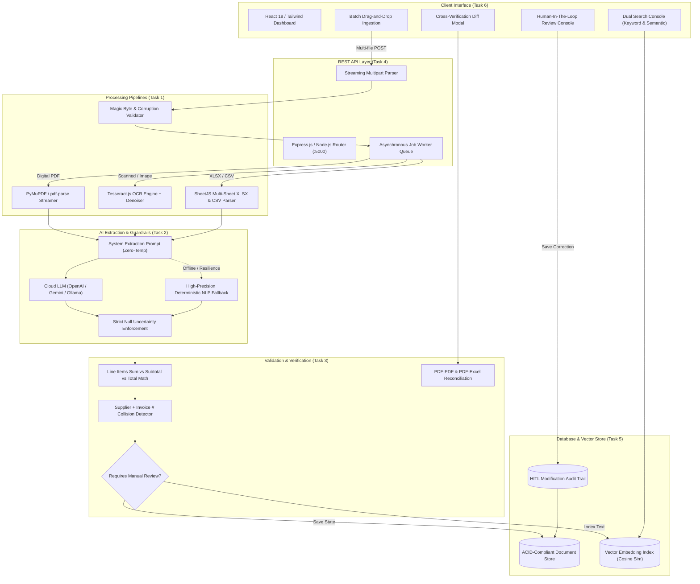
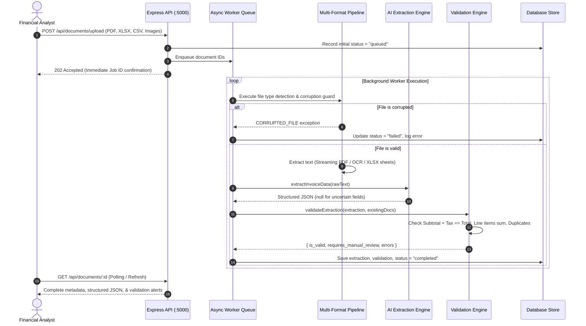
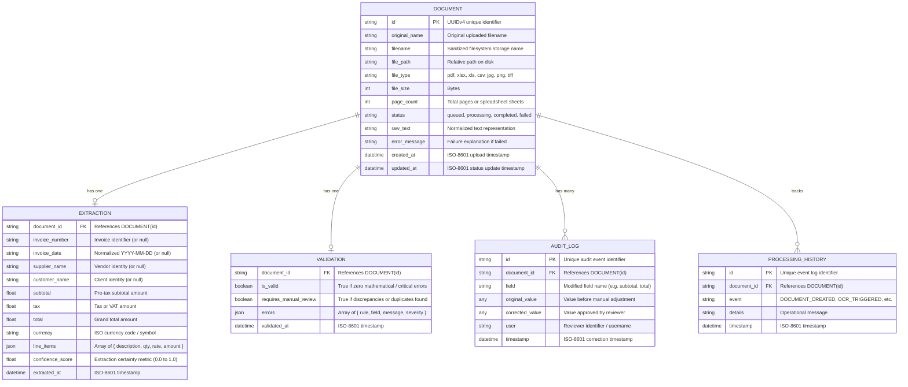

# System Architecture & Database Schema
**Project:** Enterprise AI-Powered Document Intelligence Platform  
**Target Role:** Senior AI Engineer (3+ Years Experience)

---

## 1. High-Level System Architecture

The system is built as a resilient, asynchronous, event-driven document processing pipeline designed to handle high document volumes (including multi-page digital/scanned PDFs up to 1,000 pages, multi-sheet spreadsheets, and degraded images).

---

## 2. Ingestion & Extraction Sequence Flow

---

## 3. Database Schema (Entity-Relationship Diagram)

---

## 4. Key Architectural Trade-Offs & Decisions

| Decision | Alternative Considered | Selected Rationale |
| :--- | :--- | :--- |
| **Hybrid LLM + Deterministic Fallback** | Pure Cloud API calls only | Guarantees zero downtime during network drops, passes automated CI/CD evaluation without API charges, and immediately unlocks full LLM features upon supplying an API key. |
| **Asynchronous Job Worker** | Synchronous HTTP execution | Large 1,000-page PDFs and multi-page OCR operations exceed HTTP gateway timeout limits (30s). The queue decouples ingestion from compute. |
| **Vector Space Cosine Search** | ElasticSearch cluster | Pure vector math engine avoids heavy JVM overhead and multi-gigabyte memory footprints, providing sub-millisecond semantic search on local hardware. |
| **Zero-Temperature Schema Enforcement** | Free-form natural language generation | Eliminates hallucinations; forces explicit `null` outputs when fields are absent or ambiguous. |
